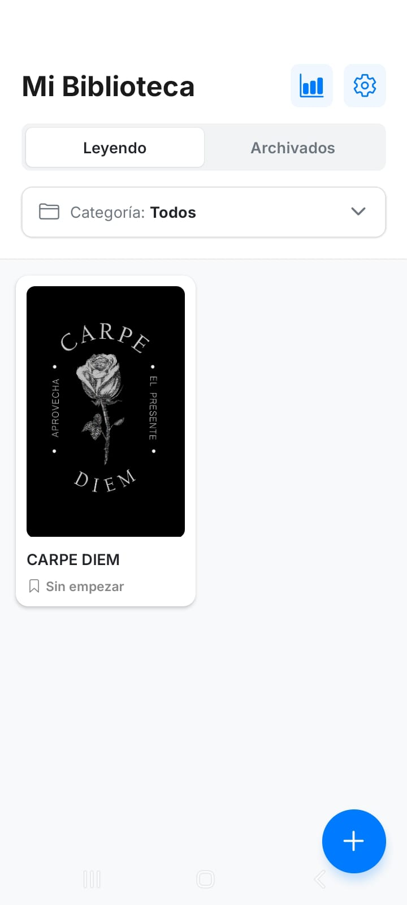
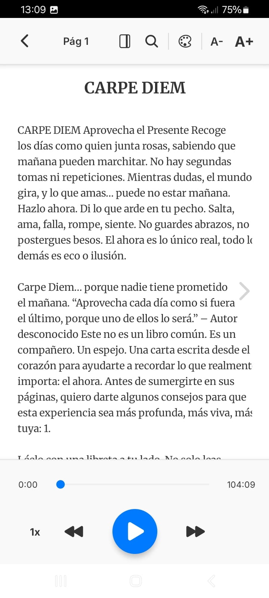
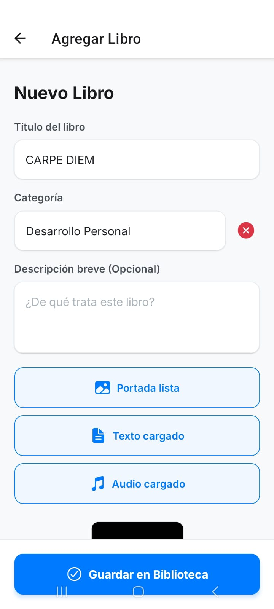

# 📚 MyLib Reader

Una aplicación móvil multiplataforma desarrollada con React Native y Expo, diseñada para unificar la experiencia de lectura y escucha de audiolibros. Pensada para fomentar el hábito de la lectura mediante un sistema avanzado de estadísticas, seguimiento de consistencia y una interfaz completamente inmersiva.

## ✨ Características Principales

* **Lector Inmersivo (TXT):** Motor de renderizado paginado optimizado para archivos extensos. Modo sin distracciones, temas de papel (Claro, Sepia, Oscuro), ajuste de tamaño de fuente e interlineado, resaltado de búsquedas y **barra de progreso de lectura**. Las preferencias del lector se recuerdan entre libros.
* **Reproductor de Audio Integrado:** Audiolibros con velocidad de reproducción (1x a 2x con corrección de tono), saltos de 15 segundos y sincronización de posición.
* **Sincronización Audio ↔ Texto:** El párrafo que se está narrando se resalta en pantalla, la página avanza sola y el scroll acompaña, para no perder el hilo. Funciona con solo el `.txt` + audio (estimación proporcional), se puede calibrar manualmente desde el lector, y admite archivos de tiempos `.srt` / `.vtt` / `.json` para máxima precisión. Ver [`docs/SINCRONIZACION.md`](docs/SINCRONIZACION.md).
* **Dashboard de Rendimiento:** Panel analítico que rastrea rachas de consistencia, minutos escuchados, páginas leídas, notas totales, historial mensual y un resumen anual con el mes más productivo.
* **Gestión Inteligente de Biblioteca:** Buscador por título/autor, ordenamiento (recientes, título, progreso), categorías dinámicas, archivado y auto-archivado opcional al terminar.
* **Modo Oscuro Real:** Tema Sistema / Claro / Oscuro aplicado en toda la app y persistido.
* **Resaltados y Notas:** Mantené presionado un párrafo y elegí **“Recordar esta parte”**: queda marcado con una barra sutil al margen y se genera una nota con la cita. Podés **extender** la marca a los párrafos siguientes para cubrir pasajes largos, agregarle un comentario, y desde “Mis Notas” volver al fragmento exacto (no solo a la página). Conviven con las notas escritas a mano de siempre. La unidad de marcado es el bloque de ~280 caracteres (limitación de React Native: no expone la selección de texto dentro de un `<Text>`).
* **Biblioteca en la nube:** La sesión, fichas, textos, portadas, notas, progreso y estadísticas se sincronizan con Supabase. Un libro agregado desde la PC aparece al abrir la app en el celular.
* **Biblioteca automática sin conexión:** Los audiolibros viven en un bucket privado de Supabase Storage y, al iniciar sesión, texto, portada, subtítulos y audio se descargan al almacenamiento permanente de cada dispositivo.
* **Offline-First real:** La PWA y los libros descargados abren sin Internet. El progreso se guarda localmente durante el viaje y se combina con Supabase al recuperar conexión o volver a primer plano.

## 📕 Preparar libros (texto + audiolibro + sincronización)

El repo incluye un pipeline propio que convierte los chunks crudos de un PDF en
los tres archivos que consume la app: `LIBRO.txt`, `AUDIOLIBRO.mp3` y
`AUDIOLIBRO.srt`. Limpia el ruido editorial, reconstruye los párrafos que la
extracción del PDF destruye y genera el audio con tiempos exactos (los toma del
propio TTS, sin transcribir ni estimar).

👉 **Runbook completo en [`tools/README.md`](tools/README.md)** — pensado para
retomarlo sin contexto previo.

```bash
python tools/procesar_libro.py LIBRO1/CHUNKS LIBRO1/SALIDA --reglas LIBRO1/reglas.json
python tools/generar_audio.py  LIBRO1/SALIDA
```

Si los chunks vienen degradados (sin puntuación, con texto sin descifrar o con
pasajes duplicados), se extrae de nuevo desde el PDF antes de procesar:

```bash
python tools/extraer_pdf.py "ruta/al/LIBRO.pdf" LIBRO2/CHUNKS_PDF
python tools/procesar_libro.py LIBRO2/CHUNKS_PDF LIBRO2/SALIDA --reglas LIBRO2/reglas.json
```

## 🛠️ Tecnologías Utilizadas

* **Frontend:** React Native, Expo, React Navigation (Expo Router).
* **Lenguaje:** TypeScript.
* **Estado y Datos:** Context API, AsyncStorage.
* **Multimedia:** `expo-audio` (Audiolibros), `expo-file-system` (Gestión de archivos locales).
* **UI/UX:** Componentes nativos optimizados (`VirtualizedList` / `FlatList`), Reanimated, Expo Vector Icons.

## 📱 Capturas de Pantalla

|     Inicio & Biblioteca     |       Lector Inmersivo      |           Agregar Libro           |
| :-------------------------: | :-------------------------: | :-------------------------------: |
|  |  |  |

---

## ☁️ Puesta en marcha de la nube (una sola vez)

1. Ejecutar [`docs/supabase_schema.sql`](docs/supabase_schema.sql) en un proyecto nuevo, o solo [`docs/supabase_cloud_library.sql`](docs/supabase_cloud_library.sql) si ya existían las tablas.
2. Configurar `EXPO_PUBLIC_SUPABASE_URL` y `EXPO_PUBLIC_SUPABASE_ANON_KEY` en `.env`.
3. Crear el usuario desde Supabase Authentication. La app no expone registro público.

El bucket `book-files` es privado y las políticas solo permiten acceder a la carpeta cuyo nombre coincide con el usuario autenticado. La migración admite archivos de hasta 5 GB, aunque el límite efectivo también depende del plan de Supabase.

## 🌐 Web sin levantar nada en la PC

La versión compilada se publica en [GitHub Pages](https://diegoklp1.github.io/libros-reader-web/) desde el repositorio público `libros-reader-web`; este repositorio principal y los archivos de trabajo siguen privados. La app incluye un manifiesto instalable para agregarla al escritorio o a la pantalla de inicio.

En Android, abrir esa URL con Chrome y elegir **Instalar aplicación**. Después del primer login conviene esperar a que Configuración muestre todos los libros como guardados: desde ese momento la aplicación, los textos y los audios abren sin conexión. El avance realizado offline se sube automáticamente cuando vuelve Internet.

## 🚀 Instalación y Uso Local

Para correr este proyecto en tu entorno local, asegurate de tener instalado:

* Node.js (versión LTS recomendada)
* npm o yarn
* Expo (se ejecuta mediante `npx`)

### 1️⃣ Clonar el repositorio

```bash
git clone https://github.com/diegoklp1/MyLib-Reader.git
cd MyLib-Reader
```
---

### 2️⃣ Instalar dependencias

Con npm:

```bash
npm install
```

O con yarn:

```bash
yarn
```

---

### 3️⃣ Iniciar la aplicación

```bash
npx expo start
```

Luego podés:

* Escanear el QR con **Expo Go** en tu dispositivo físico.
* Presionar `a` para abrir en un emulador Android.
* Presionar `i` para abrir en simulador iOS (solo macOS).

---

## 👨‍💻 Autor

**Diego**

* LinkedIn: [https://www.linkedin.com/in/llanos-diego](https://www.linkedin.com/in/llanos-diego)
* GitHub: [https://github.com/diegoklp1](https://github.com/diegoklp1)

---

*Si esta aplicación te pareció interesante o te fue útil, ¡no dudes en dejar una ⭐ en el repositorio!*
